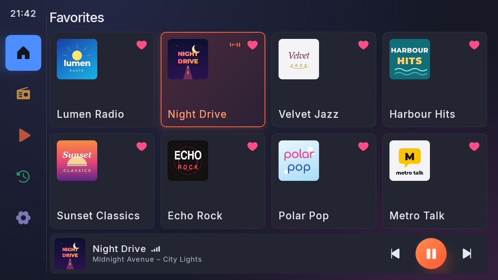
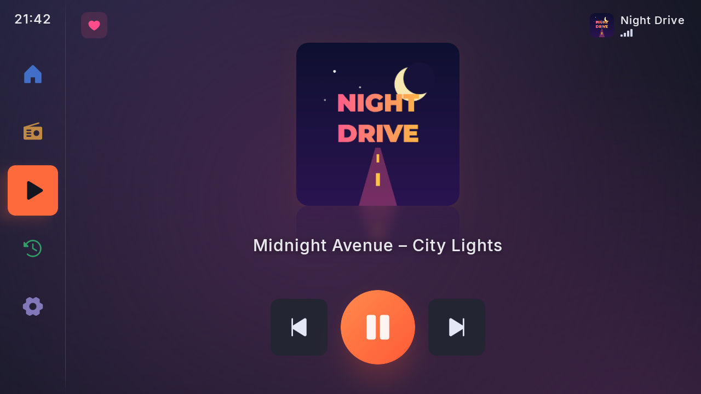
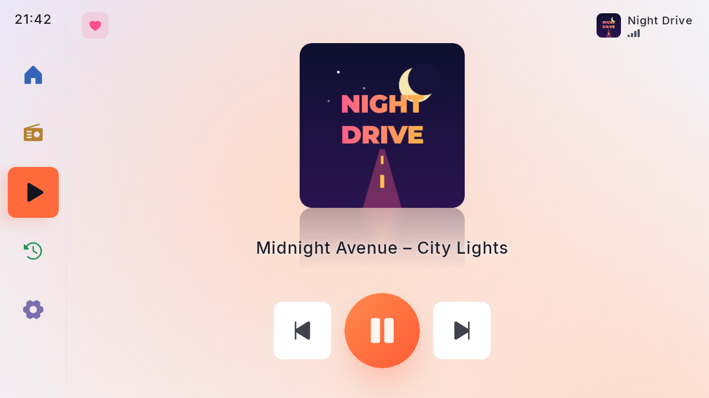
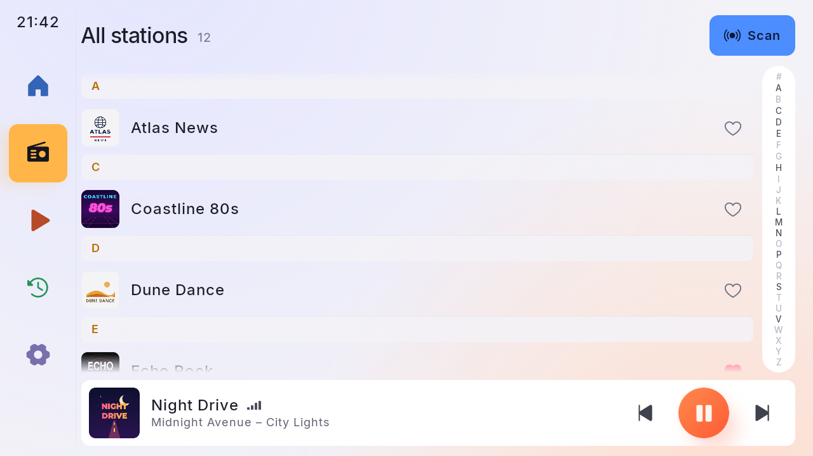

<p align="center"></p>

# DABplay+ FM

**This is a fork of [DABplay+](https://github.com/jvspier/dabplayplus) (MIT) that adds FM.** It puts DAB+ through a
USB dongle and the head unit's built-in FM tuner into one app, for FYT head units (UIS7862 and similar, the ones with
`com.syu.ms`, e.g. the EKIY T900). It installs as its own app, "DABplay+ FM" (`io.github.creafy.dabplayfm`), next to
DABplay+.

**Download:** the signed APK is on this fork's [Releases](https://github.com/creafy/dabplayplusfm/releases) page
(tags `fm-v…`); what changed is in the [changelog](CHANGELOG.md).

What the fork adds:

- **One station, one tile**: a station's DAB service and its FM frequency are one station. **The best source is
  picked automatically**: DAB first, FM when DAB is lost for 2.5 s or weak for 6 s, and back to DAB after 5 s of good
  reception. DAB keeps receiving silently in the meantime. The source pill on Now playing switches between automatic,
  DAB and FM by hand.
- **FM station list without RDS**: the app carries the German Wikipedia's lists of FM transmitters in Germany,
  Austria and Switzerland (offline,
  CC BY-SA 4.0, see `android/app/src/main/assets/licenses/fm-transmitters.txt`). With the head unit's location,
  **Scan FM fills in the programmes in reach** without seeking, and again after 15 km. Without a location it runs a
  seek scan and works out the place from the frequencies it found.
- **Linking DAB and FM**: through the FM frequencies a multiplex announces (FIG 0/6 + 0/21), otherwise by name
  ("NDR 2" ↔ "NDR 2 Hamburg", "DLF" ↔ "Deutschlandfunk (Dlf)"), otherwise by hand (the link button on Now playing).
- **The strongest FM frequency while driving**: once the frequency playing is out of reach, a station on FM moves to
  its programme's strongest frequency.
- On FM, Now playing has seek and step buttons. Settings → FM test shows the raw connection to the tuner.

How FM works on these units: the app talks to the head unit's MainServer over Binder ([docs/fyt-radio.md](docs/fyt-radio.md)).
On most units (`sys.fyt.radio_type` 3/4, the T900 among them) the stock radio app `com.syu.radio` drives the FM chip
itself. It runs in the background, its screen opens briefly the first time FM is tuned, and it doesn't pass RDS names
on, which is what the transmitter list is for. DAB stays fully silent while FM plays, otherwise the head unit would
switch its radio off. Transmitter lists for Germany, Austria and Switzerland so far; FM only (no AM).

Status: in daily use on an EKIY T900 (FYT, UIS7862, Android 10) since November 2026. The original DABplay+ README
follows. Its download and Play links point to the upstream app, which has no FM.

---

A car-friendly DAB+ radio app for Android head units, driving a cheap USB DAB+ dongle directly.
Big tiles, big text, few taps: made to be used while driving.

**The original DABplay+ (without FM):** its APK is on the [Releases](https://github.com/jvspier/dabplayplus/releases) page of
the original project. Website: [jvspier.github.io/dabplayplus](https://jvspier.github.io/dabplayplus/).

**Google Play:** DABplay+ is in a closed test before it goes public, and Google wants 12 testers for 14 days. Want to
help? Join the [tester group](https://groups.google.com/g/dabplay-testers), then open the [test page](https://play.google.com/apps/testing/io.github.jvspier.dabplay) with the same Google
account, tap "Become a tester" and install it from Play. No dongle needed: without one you can still open every screen.



| Now playing (night) | Now playing (day) |
|---|---|
|  |  |
| **Stations (day)** | **Side-panel layout (day)** |
|  |  |

## Features

- **Favourites grid**: eight large tiles on one screen, up to 24, reorder by long-press and drag.
- **Now playing**: "Artist – Title" from the broadcast (DLS / DL Plus), and the station's slideshow (cover cards,
  shown whole, never cropped) or its logo, standing on a soft reflection.
- **Station logos**, downloaded automatically when online (RadioDNS, then the station's website, then
  radio-browser.info) and cached; Settings shows how many were found, with Retry missing and Refresh all. Offline,
  everything else still works.
- **DAB+ and DAB (MP2)** stations; DAB uses the app's own MPEG Layer II decoder.
- **Reception handling**: live signal bars, "No signal" while in a tunnel, resumes by itself. Short errors become a
  brief mute instead of a stutter.
- **Follow station**: when the signal is gone, switches to the same station on another multiplex, using what the
  broadcast announces about itself.
- **Traffic announcements** (optional, off by default): switches to traffic news on the same multiplex and back,
  with a banner and Skip; a "TA" badge shows when the station takes part.
- **Plays nicely in the car**: silent during phone calls, quieter under navigation prompts; steering-wheel buttons
  through a proper media session; auto-resume of the last station; Back never leaves the radio by accident.
- **Start with the car** (optional, off by default): opens DABplay+ when the car starts; off, it stays out of the way
  of CarPlay / Android Auto even though the dongle is always connected.
- Two layouts (player bar or side panel), day/night theme, controls on the driver's side (left or right), full screen
  or next to the head unit's own bars.
- **Backgrounds**: four tints for the page behind everything (Dusk, Ocean, Ember, Aurora), each with a day and a night
  version, plus an optional **Pure black at night** for driving in the dark. Tiles, text and icons stay the same.

## Hardware

- **Android 8 (API 26) and up**, landscape. Designed on a 1280×720 head unit; also fits phones in landscape, smaller
  head units (1024×600) and larger screens.
- **A USB DAB+ dongle** from the list below.

### Supported dongles

| Dongle | USB ID | Status |
|---|---|---|
| wRadio C100 / DTR-100 / "DAB+ Receiver for Android Navigation" (single antenna), sold under many brands. Confirmed by users: CAMECHO, and sticks that name themselves `wshtyr@126.com` or `dabusb@126.co` (the last one plays since 1.3.6) | `16c0:05dc` | **Tested** |
| C100 "Dual Antenna" (YHX) | `16c0:05dc`, same | **Untested** ([protocol](docs/protocol-c100-highlevel.md)) |
| Si4684 module: Eonon A503, XFA-DAB220 | `1a86:5537` | **Untested** ([protocol](docs/protocol-si4684.md)). The module decodes by itself: no traffic announcements, and service following is the module's own |
| Siano SMS2160 "Rhine800" / Denver TDMB | `187f:0800`, `187f:0700`, `187f:0802` | **Untested** ([protocol](docs/protocol-siano.md)) |
| Siano SMS2270 "Rio" | `187f:0600` | Not supported: needs vendor firmware we can't distribute |

> **About "untested":** only the first dongle has been tested on real hardware. Support for the others is written
> from public sources and from how other apps talk to them, with automated tests against that description, but
> nobody has run it with the real dongle yet. It may work, partly work or not work at all. If you have one of these
> dongles, please send a [dongle report](https://github.com/jvspier/dabplayplus/issues/new?template=dongle-report.yml) and say how it went, with the file from **Settings → Diagnostics log**
> (Save or Share; it lists the USB devices and what the app did, no song titles), and this table gets updated. Other dongle families are catalogued in
> [docs/dongles.md](docs/dongles.md).

## Status

Released (the [changelog](CHANGELOG.md) has the latest version), in a closed test on Google Play (see above). In daily use in a car on a Dudu3 head unit (Android 10, budget-class hardware)
with the DTR-100 dongle: quick and responsive, and through a tunnel it shows "No signal" and is back quickly after
it. Before that it was tested with the same dongle in the Android emulator (USB passthrough): scan, playback,
switching, text, slides, logos, reception loss and recovery, dongle dropouts. The app is tuned for budget head units
(one cached background layer, a baseline profile, decoding that costs well under 1 % of a core).

Not yet verified on air: MP2 (the Netherlands has no MP2 stations; tested against reference files), a real traffic
announcement switch, and following a station to another multiplex while driving (both are covered by tests against
a simulated tuner). Other dongles: see the table above.

## Roadmap

- **RTL-SDR sticks** (RTL2832U): these don't decode DAB themselves, so the app would have to demodulate the signal on
  the head unit. A big project of its own, planned for later ([docs/dongles.md](docs/dongles.md)).

## Building

Needs JDK 25 and the Android SDK:

```
cd android
echo "sdk.dir=$HOME/Android/Sdk" > local.properties      # your SDK path
./gradlew test assembleRelease
```

See [android/README.md](android/README.md) for the emulator setup with USB passthrough.

## Documentation

- [docs/architecture.md](docs/architecture.md): modules, driver interface, playback.
- [docs/protocol.md](docs/protocol.md): the DTR-100's USB protocol;
  [protocol-c100-highlevel.md](docs/protocol-c100-highlevel.md), [protocol-si4684.md](docs/protocol-si4684.md) and
  [protocol-siano.md](docs/protocol-siano.md) for the other dongles.
- [docs/findings.md](docs/findings.md): hardware findings and the test log.
- [docs/design-notes.md](docs/design-notes.md): UI decisions.
- `tools/`: the Python proof of concept, the reference implementation.

The dongle protocol was reverse engineered for interoperability. This repository contains no vendor apps or
binaries. Station names and logos shown belong to their broadcasters.

## Licence

[MIT](LICENSE). Third-party parts keep their own licences: the Inter font (SIL Open Font License,
`android/app/src/main/assets/licenses/Inter-OFL.txt`), Phosphor icons (MIT), OkHttp and AndroidX/Media3 (Apache 2.0),
dnsjava (BSD).
